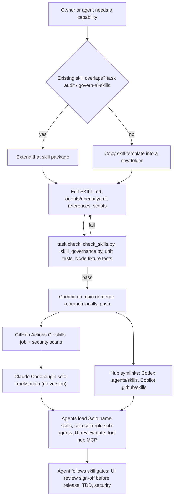
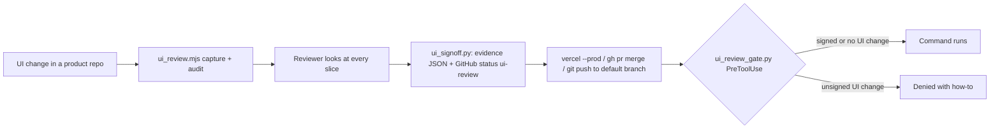

# 01 — Business process (As-Is / To-Be)

repo นี้เป็น **skills/content repo** ไม่ใช่ service: เนื้อหาหลักคือ skill packages (`<name>/SKILL.md` + `agents/openai.yaml`
+ `references/` / `scripts/` ตามจำเป็น) และ Claude Code plugin `solo` ที่ห่อ skills, sub-agents 9 ตัว, UI review gate (PreToolUse hook)
และการลงทะเบียน tool hub MCP. "กระบวนการธุรกิจ" จึงเป็น **วงจรชีวิตของ skill**: เขียน/แก้ → ตรวจ → merge `main` → ถึงทุก harness

## As-Is (จากโค้ดวันนี้, `origin/main` `baae94a`)

Sources: README.md, PRODUCT.md, Taskfile.yml, scripts/check_skills.py, scripts/skill_governance.py, skill-template/SKILL.md,
govern-ai-skills/SKILL.md, .claude-plugin/plugin.json, .claude-plugin/marketplace.json, hooks/hooks.json, .mcp.json,
.github/workflows/ci.yml, git log origin/main

กระบวนการย่อยที่ skill บังคับใช้ใน repo อื่น (ทำงานจริงด้วย script ใน repo นี้) คือ **UI release gate**:

Sources: qa-testing/scripts/ui_review.mjs, qa-testing/scripts/ui_signoff.py, qa-testing/scripts/ui_review_gate.py,
qa-testing/scripts/ui_review_evidence.py, hooks/hooks.json, qa-testing/SKILL.md

ข้อสังเกต As-Is:
- CI รันเฉพาะ `check_skills.py`, `skill_governance.py`, `skill_governance_test.py`, `plugin_agents_test.py` (ci.yml `test-command`);
  `ui_review_gate_test.py` และ Node fixture tests อยู่ใน `task check` เท่านั้น (gap, ดู 15/17)
- Codex review Stop gate ถูกถอดออกจาก plugin แล้ว (ebb1298, 2026-10-21); `hooks/hooks.json` มีแค่ PreToolUse UI review gate

## To-Be

repo ไม่มี `specs/`, `docs/UPGRADE-PLAN.md` และไม่มี issue ที่เปิดอยู่ (`gh pr list` มีแค่ PR #1–#9 ที่ปิดแล้ว). PRODUCT.md มีแค่เป้าหมายเชิง Measures:
`task check` + governance audit ผ่านบน `main` เสมอ, overlapping triggers = 0, และนับ request ที่ agent พลาด gate (ยัง `[ต้องยืนยัน]` ว่าบันทึกที่ไหน).
ไม่มีกระบวนการ To-Be ที่เขียนไว้ จึงไม่วาด To-Be

## Open questions

- To-Be ของ skill hub คืออะไร (version/release channel ของ plugin, การรัน gate tests ใน CI)?
- บันทึก "agent missed a required gate" อยู่ที่ไหน (PRODUCT.md Measures ระบุ `[ต้องยืนยัน]`)?
