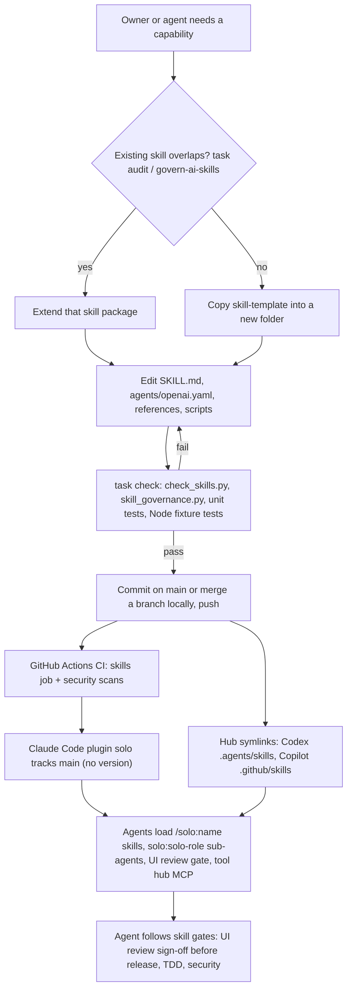
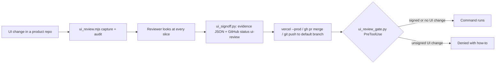

# 01 — Business process (As-Is / To-Be)

repo นี้เป็น **skills/content repo** ไม่ใช่ service: เนื้อหาหลักคือ skill packages (`<name>/SKILL.md` + `agents/openai.yaml`
+ `references/` / `scripts/` ตามจำเป็น) และ Claude Code plugin `solo` ที่ห่อ skills, sub-agents 9 ตัว, UI review gate (PreToolUse hook)
และการลงทะเบียน tool hub MCP. "กระบวนการธุรกิจ" จึงเป็น **วงจรชีวิตของ skill**: เขียน/แก้ → ตรวจ → merge `main` → ถึงทุก harness

Last reviewed: 2026-11-27 · commit `5ef138a`

## As-Is (จากโค้ดวันนี้)

Sources: README.md, PRODUCT.md, Taskfile.yml, scripts/check_skills.py, scripts/skill_governance.py, skill-template/SKILL.md,
govern-ai-skills/SKILL.md, .claude-plugin/plugin.json, .claude-plugin/marketplace.json, hooks/hooks.json, .mcp.json,
.github/workflows/ci.yml, git log origin/main

กระบวนการย่อยที่ skill บังคับใช้ใน repo อื่น (ทำงานจริงด้วย script ใน repo นี้) คือ **UI release gate**:

Sources: qa-testing/scripts/ui_review.mjs, qa-testing/scripts/ui_signoff.py, qa-testing/scripts/ui_review_gate.py,
qa-testing/scripts/ui_review_evidence.py, hooks/hooks.json, qa-testing/SKILL.md

ข้อสังเกต As-Is:
- CI รันเฉพาะ `check_skills.py`, `skill_governance.py`, `skill_governance_test.py`, `plugin_agents_test.py`, `drive_publish_test.py` (ci.yml `test-command`);
  `ui_review_gate_test.py` และ Node fixture tests อยู่ใน `task check` เท่านั้น (G2)
- Codex review Stop gate ถูกถอดออกจาก plugin แล้ว (ebb1298, 2026-10-21); `hooks/hooks.json` มีแค่ PreToolUse UI review gate

## To-Be (ไม่มีที่เขียนไว้)

ไม่มี To-Be ที่เขียนไว้ — repo ไม่มี `specs/`, ไม่มี `docs/UPGRADE-PLAN.md` และไม่มี roadmap; ADR ที่มีคือ `docs/diagrams/08-adr/ADR-0002-plugin-marketplace-tracks-main.md` (accepted: plugin `solo` ไม่มี `version` และ track `main`) ซึ่งเป็นนโยบาย release ปัจจุบัน ไม่ใช่ภาพกระบวนการเป้าหมาย; `PRODUCT.md` §Measures มีแค่ตัวชี้วัด (`task check` + governance audit ผ่านบน `main` เสมอ, overlapping triggers = 0, นับ request ที่ agent พลาด gate) ไม่ใช่กระบวนการเป้าหมาย จึงไม่วาด To-Be

Sources: `PRODUCT.md` §Measures, `.github/workflows/ci.yml`, `Taskfile.yml`

## Gap

| ID | As-Is → To-Be | Status | Owner | Evidence |
|---|---|---|---|---|
| G1 | ไม่มี To-Be ของกระบวนการ skill hub ที่เขียนไว้ (release channel ตัดสินแล้วใน ADR-0002: track `main` ไม่มี version) → owner กำหนด To-Be ของกระบวนการ | decide | owner | `docs/diagrams/08-adr/ADR-0002-plugin-marketplace-tracks-main.md`, `.claude-plugin/plugin.json`; ไม่มี spec หรือ roadmap |
| G2 | CI ไม่รัน `tests/ui_review_gate_test.py` และ Node fixture tests ทั้งหมด → CI รันชุดเดียวกับ `task check` ตามที่ comment ใน ci.yml ระบุ | todo | claude | `.github/workflows/ci.yml` `test-command` เทียบ `Taskfile.yml` task `check` |
| G3 | ไม่มีที่บันทึก request ที่ agent พลาด gate → มีตัวนับตาม Measures | decide | owner | `PRODUCT.md` §Measures `[ต้องยืนยัน]` ว่าบันทึกที่ไหน |

## Open questions

- To-Be ของกระบวนการ skill hub คืออะไร (G1; release channel ตาม ADR-0002 แล้ว)? การรัน gate tests ใน CI ดู G2
- (G3) บันทึก "agent missed a required gate" อยู่ที่ไหน (PRODUCT.md Measures ระบุ `[ต้องยืนยัน]`)?
