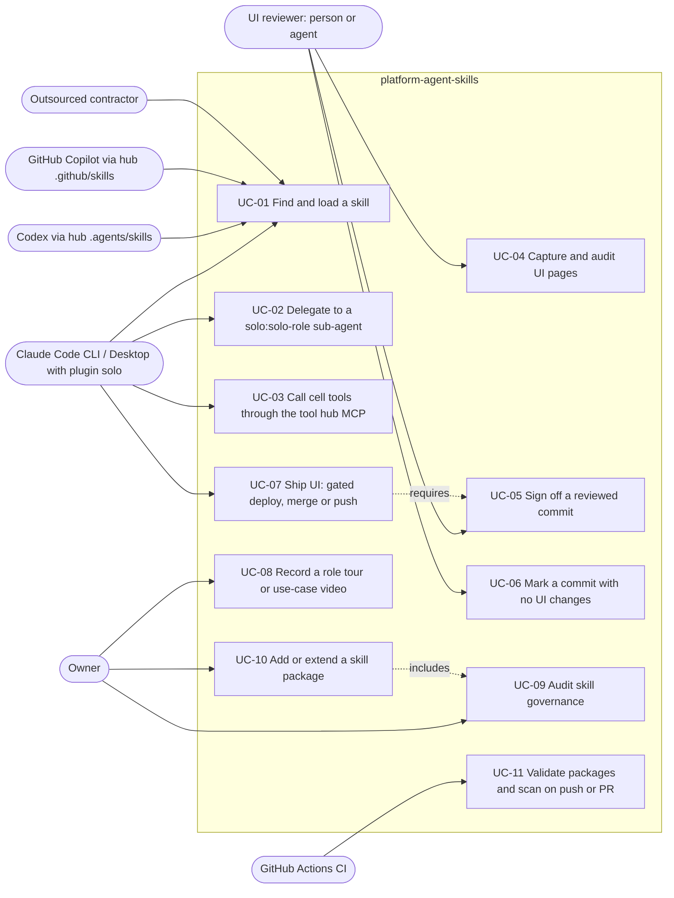

# 02 — Use cases

ไม่มี auth level ในโค้ด (ไม่ใช่ service). actors = ผู้ใช้และ harness ที่ PRODUCT.md ระบุ + automation ที่เรียก script จริง

Sources: PRODUCT.md (Users), README.md, agents/*.md, .mcp.json, hooks/hooks.json, qa-testing/scripts/ui_review.mjs,
qa-testing/scripts/ui_signoff.py, qa-testing/scripts/ui_review_status.py, qa-testing/scripts/ui_review_gate.py,
flow-video/scripts/flow_video.mjs, scripts/skill_governance.py, Taskfile.yml, .github/workflows/ci.yml

| UC | Entry point (จริงในโค้ด) | หมายเหตุ |
|---|---|---|
| UC-01 | `<name>/SKILL.md` frontmatter `description` | 24 packages + `vendor/impeccable`; plugin.json `skills: ["./", "./vendor/"]` |
| UC-02 | `agents/solo-*.md` | 9 roles; writers = solo-implementer, solo-debugger (tests/plugin_agents_test.py) |
| UC-03 | `.mcp.json` → `hooks/mcp_auth_header.py` | tools อยู่ใน Worker อีก repo (platform-mcp-remote-worker) |
| UC-04 | `node qa-testing/scripts/ui_review.mjs`, `node ux-review/scripts/ui_states.mjs`, `ui_login.mjs` | ต้องมี Playwright |
| UC-05 | `python3 qa-testing/scripts/ui_signoff.py` | ปฏิเสธเมื่อมี blocker หรือไม่มีความกว้าง 375 + 1280/1440 |
| UC-06 | `python3 qa-testing/scripts/ui_review_status.py` | post `ui-review=success` เมื่อไม่มีไฟล์ UI เปลี่ยน |
| UC-07 | PreToolUse hook matcher `Bash` | ตรวจ `vercel --prod`/`--production`/`promote`, `gh pr merge`, `git push` ไป default branch |
| UC-08 | `node flow-video/scripts/flow_video.mjs --scenarios <file>` | read-only by default (GET/HEAD/OPTIONS) |
| UC-09 | `task audit` / `task check` | contract `solo-empire.skill-governance.v1` |
| UC-10 | `skill-template/`, `govern-ai-skills/SKILL.md` | |
| UC-11 | `.github/workflows/ci.yml` | jobs `skills`, `security` |

## Open questions

- contractor ใช้ skills ผ่าน harness ใด (PRODUCT.md ระบุว่า "follow the same skills" แต่ไม่ระบุช่องทางติดตั้ง)?
