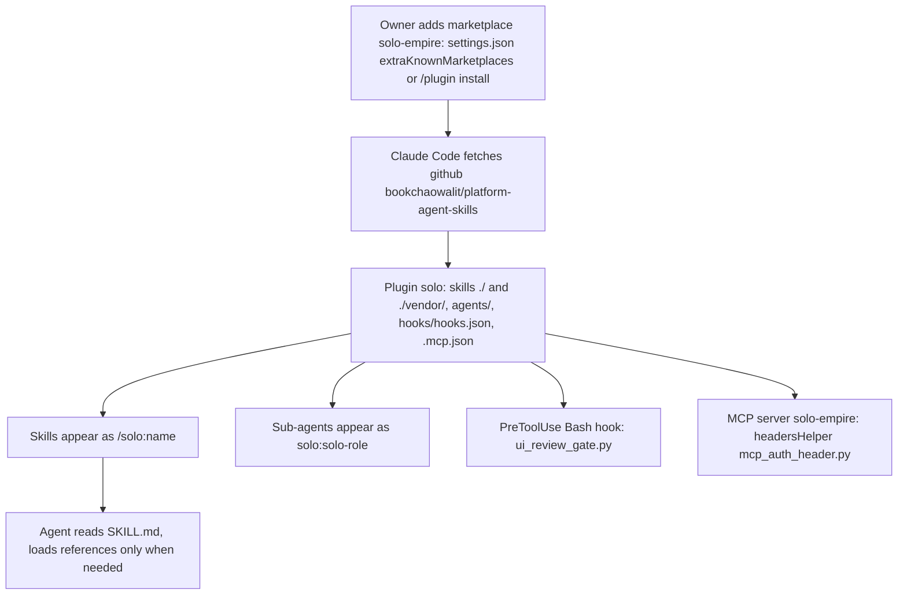
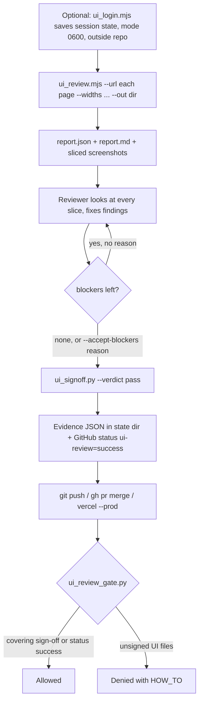
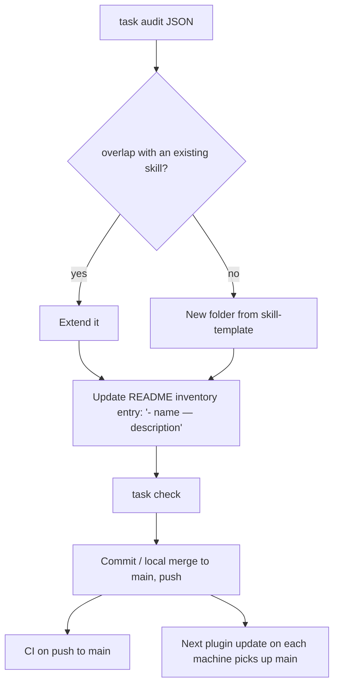
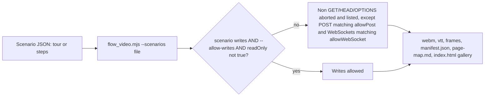

# 03 — User flows

ไม่มี routes/pages: flow ด้านล่างคือ journey ของ actor แต่ละกลุ่มผ่าน command และไฟล์จริง

## F1 — Install the skill hub and use a skill (Claude Code)

Sources: README.md (Install as a Claude Code plugin), .claude-plugin/plugin.json, .claude-plugin/marketplace.json, hooks/hooks.json, .mcp.json

## F2 — Ship a UI change (reviewer + agent in a product repo)

Sources: qa-testing/scripts/ui_login.mjs, qa-testing/scripts/ui_review.mjs, qa-testing/scripts/ui_signoff.py,
qa-testing/scripts/ui_review_evidence.py, qa-testing/scripts/ui_review_gate.py

PR ที่ไม่แตะไฟล์ UI: `ui_review_status.py --base origin/main` post `success` "no UI changes" (ใช้เมื่อ branch rule บังคับ status)

## F3 — Change a skill (owner / maintainer)

Sources: README.md, Taskfile.yml, scripts/skill_governance.py (README_ENTRY_PATTERN), skill-template/SKILL.md, .github/workflows/ci.yml

## F4 — Record walkthrough videos

Sources: flow-video/scripts/flow_video.mjs (SAFE_METHODS, line 472 writes rule), flow-video/references/scenario-format.md, flow-video/SKILL.md

## Open questions

- ไม่มีขั้นตอนบันทึกการติดตั้ง plugin บนเครื่องใหม่ในรูป checklist นอกจาก README; ต้องการหรือไม่?
