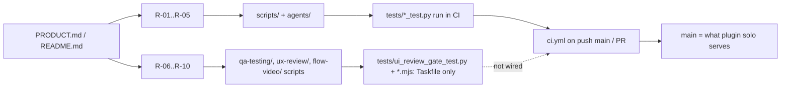

# 04 — Traceability (RTM)

repo ไม่มี `specs/`; requirement มาจาก PRODUCT.md (Capabilities and Constraints, Measures) และ README.md.
"Release" ของ repo นี้ = commit บน `main` ที่ plugin `solo` track (ไม่มี version/tag)

| ID | Requirement (แหล่ง) | Code module | Test file | CI / release |
|---|---|---|---|---|
| R-01 | ทุก skill มี `SKILL.md` frontmatter ถูกต้อง, ชื่อ lowercase-hyphen ตรงกับ folder (PRODUCT.md Constraints) | scripts/check_skills.py, scripts/skill_governance.py `validate_skill_package` | tests/skill_governance_test.py `test_package_validator_rejects_missing_metadata_and_large_body` | ci.yml `skills` test-command |
| R-02 | ขนาด SKILL.md ≤ 500 lines / 5,000 words, มี `agents/openai.yaml` interface ครบ | scripts/skill_governance.py | tests/skill_governance_test.py | ci.yml `skills` |
| R-03 | README inventory ตรงกับ packages | scripts/skill_governance.py `audit` (README_ENTRY_PATTERN) | tests/skill_governance_test.py `test_repository_skill_system_passes` | ci.yml `skills` |
| R-04 | Overlapping triggers = 0 (PRODUCT.md Measures) | scripts/skill_governance.py `_audit_router` | `test_router_audit_is_skipped_without_router_path` เท่านั้น | **gap**: router audit skip เมื่อไม่ตั้ง `SOLO_ROUTER_PATH` (CI ไม่ตั้ง) จึงไม่ได้วัดจริงใน CI |
| R-05 | 9 sub-agents ship, frontmatter plugin-safe, read-only roles ไม่มี write tools (README Sub-agents) | agents/*.md | tests/plugin_agents_test.py | ci.yml `skills` |
| R-06 | Gate บล็อก production deploy / PR merge / push ไป default branch ที่มี UI ไม่ได้ sign-off (PRODUCT.md Gate scripts) | qa-testing/scripts/ui_review_gate.py, ui_review_evidence.py, hooks/hooks.json | tests/ui_review_gate_test.py (18 tests) | **gap**: อยู่ใน Taskfile `check` แต่ไม่อยู่ใน ci.yml test-command |
| R-07 | Sign-off ปฏิเสธ blocker และความกว้างไม่ครบ; post status `ui-review` | qa-testing/scripts/ui_signoff.py | tests/ui_review_gate_test.py `test_signoff_refuses_blockers_and_missing_widths`, `test_signoff_posts_status_and_can_skip` | **gap**: ไม่อยู่ใน CI |
| R-08 | Commit ไม่มี UI → status success (`ui_review_status.py`) | qa-testing/scripts/ui_review_status.py | tests/ui_review_gate_test.py `test_status_script_refuses_ui_changes_and_marks_others` | **gap**: ไม่อยู่ใน CI |
| R-09 | UI audit rules, baseline diff, cross-browser, a11y/perf, login session, inner scroller | qa-testing/scripts/*.mjs, ux-review/scripts/ui_states.mjs | tests/ui_*_fixture_test.mjs (7 ไฟล์) | **gap**: Taskfile เท่านั้น และ skip (exit 0) เมื่อไม่มี Playwright |
| R-10 | flow-video read-only by default | flow-video/scripts/flow_video.mjs | tests/flow_video_fixture_test.mjs | **gap**: Taskfile เท่านั้น, skip เมื่อไม่มี Playwright |
| R-11 | ไม่มี secrets ใน package (PRODUCT.md Constraints) | — | — | ci.yml `security` (gitleaks) |
| R-12 | tool hub token ไม่ถูกเก็บใน config (README Tool hub) | hooks/mcp_auth_header.py | **ไม่มี test** (gap) | — |
| R-13 | Python validators type-checked + lint (PRODUCT.md Operating Context) | pyproject.toml `[tool.mypy]`, `[tool.ruff]` | — | ci-python steps Lint (Ruff) + Typecheck (mypy) |
| R-14 | วัดจำนวน request ที่ agent พลาด gate (PRODUCT.md Measures) | — | — | **gap**: `[ต้องยืนยัน]` ไม่มีที่บันทึก |

Sources: PRODUCT.md, README.md, Taskfile.yml, .github/workflows/ci.yml, scripts/*.py, qa-testing/scripts/*, tests/*

## Open questions

- ควรเพิ่ม `ui_review_gate_test.py` ใน ci.yml test-command หรือไม่ (gate นี้รันบนทุกเครื่องที่ติดตั้ง plugin)?
- Node fixture tests ควรรันบน CI ที่มี Playwright หรือไม่?
