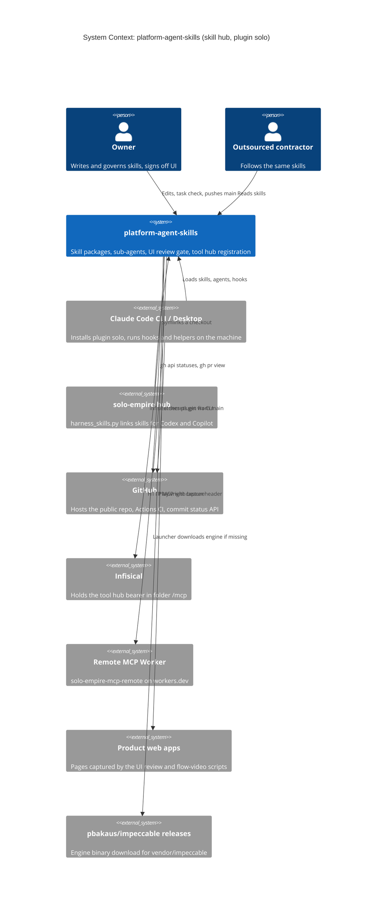

# 05 — C4 Context

Sources: PRODUCT.md, README.md, .claude-plugin/marketplace.json, .mcp.json, hooks/mcp_auth_header.py,
qa-testing/scripts/ui_review_evidence.py, qa-testing/scripts/ui_review_gate.py, qa-testing/scripts/ui_review.mjs,
vendor/impeccable/scripts/impeccable, .github/workflows/ci.yml,
central [ADR-0003 hosted shared services](https://github.com/bookchaowalit/architecture-docs/blob/main/docs/architecture/decisions/ADR-0003-hosted-shared-services.md),
ops record: hosted-shared-services (2026-11-03)

หมายเหตุ: Codex / Copilot อ่าน skills ผ่าน symlink ที่ hub สร้าง (`infra/scripts/agent/harness_skills.py --write`, อยู่ใน hub ไม่ใช่ repo นี้).
central ADR-0003 ข้อ 1 ยังเขียนว่า Codex review Stop hook ship ใน plugin แต่โค้ดปัจจุบันไม่มีแล้ว (ebb1298; ops record: ai-stack (2026-11-03))

## Open questions

- central ADR-0003 ควรได้ addendum ว่า Codex Stop gate ออกจาก plugin แล้วหรือไม่?
