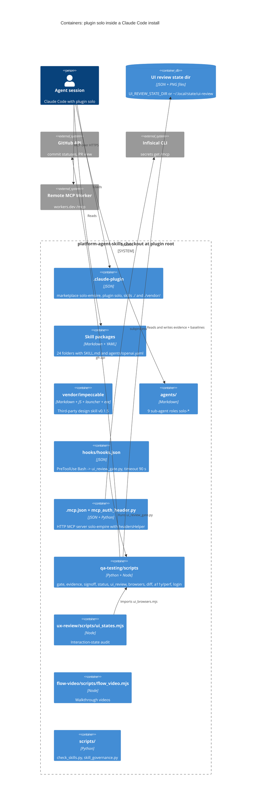

# 06 — C4 Container

"Container" ที่นี่ = ส่วนของ plugin / repo ที่ถูกโหลดหรือรันแยกกัน (ไม่มี process ที่ host อยู่)

Sources: .claude-plugin/plugin.json, .claude-plugin/marketplace.json, hooks/hooks.json, .mcp.json, hooks/mcp_auth_header.py,
agents/*.md, qa-testing/scripts/*, ux-review/scripts/ui_states.mjs, flow-video/scripts/flow_video.mjs, scripts/*.py,
vendor/impeccable/scripts/VERSION, qa-testing/scripts/ui_review_evidence.py (`state_dir`)

CI (`.github/workflows/ci.yml`) และ tests/ ไม่ถูกโหลดโดย plugin แต่อยู่ใน checkout เดียวกัน (ดู 15)

## Open questions

- ไม่มี
