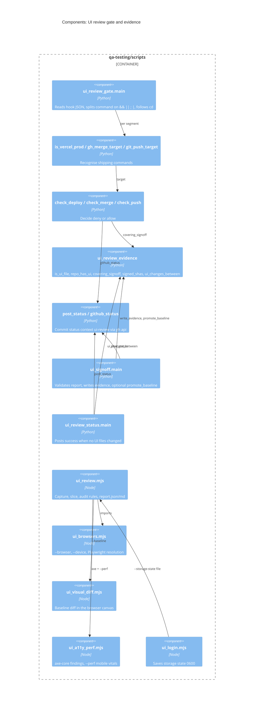
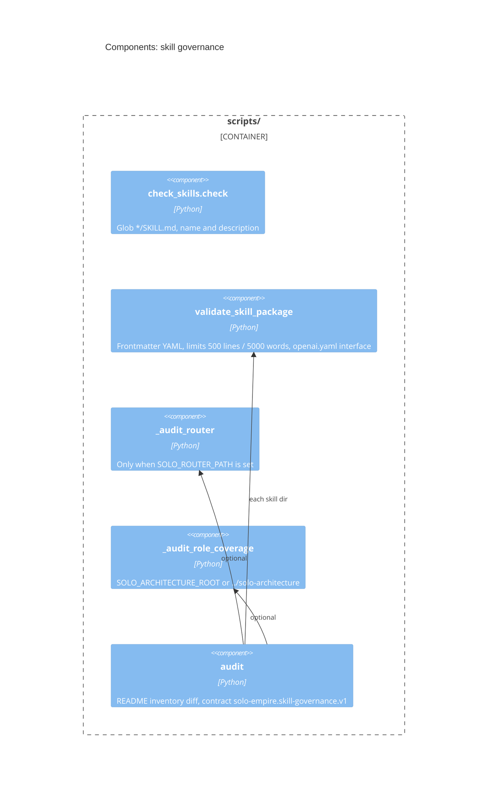

# 07 — C4 Component

## UI review gate + sign-off (qa-testing/scripts)

Sources: qa-testing/scripts/ui_review_gate.py, qa-testing/scripts/ui_review_evidence.py, qa-testing/scripts/ui_signoff.py,
qa-testing/scripts/ui_review_status.py, qa-testing/scripts/ui_review.mjs, qa-testing/scripts/ui_browsers.mjs,
qa-testing/scripts/ui_visual_diff.mjs, qa-testing/scripts/ui_a11y_perf.mjs, qa-testing/scripts/ui_login.mjs

## Governance validators (scripts/)

Sources: scripts/check_skills.py, scripts/skill_governance.py

ความคลาดเคลื่อน: README บอกว่า `SOLO_ARCHITECTURE_ROOT` default `../architecture-docs` แต่โค้ด default คือ `project_root.parent / "solo-architecture"`

## Open questions

- default ไหนถูก (`../architecture-docs` ใน README หรือ `../solo-architecture` ในโค้ด)?
