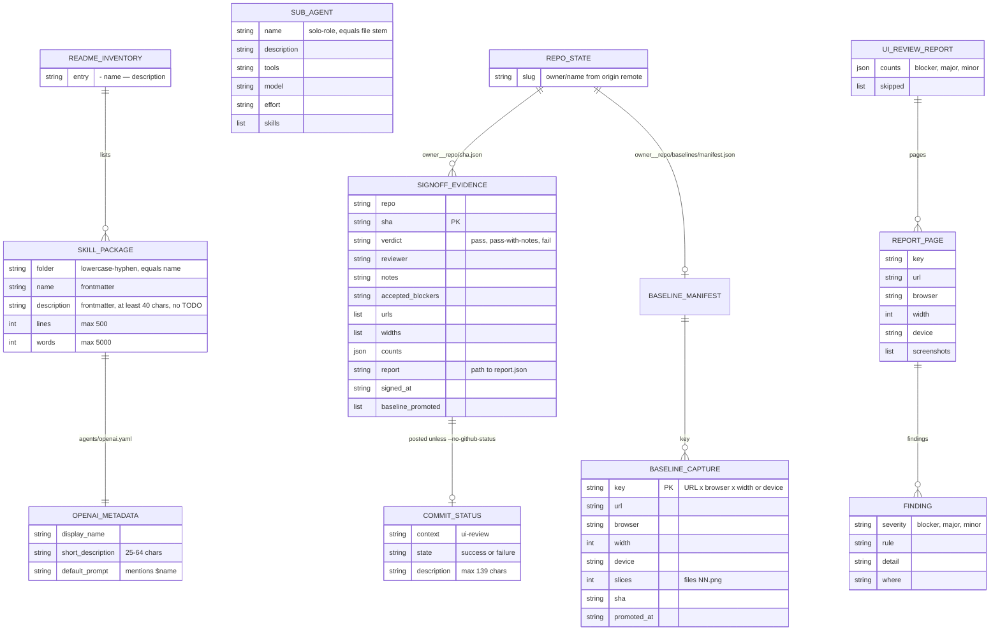

# 09 — ERD (file-based data)

ไม่มี database. ข้อมูลที่ persist คือ **ไฟล์**: (1) package metadata ใน repo, (2) evidence/baselines ที่ scripts เขียนนอก repo
ใน state dir, (3) GitHub commit status. ERD ด้านล่างแสดงโครงสร้างจริงของไฟล์เหล่านี้ (field จากโค้ดที่เขียน/อ่าน)

Sources: scripts/skill_governance.py, scripts/check_skills.py, agents/*.md, tests/plugin_agents_test.py,
qa-testing/scripts/ui_review_evidence.py (`write_evidence`, `promote_baseline`, `post_status`), qa-testing/scripts/ui_signoff.py (`record`),
qa-testing/scripts/ui_review.mjs (`add`, report.json write), qa-testing/scripts/ui_visual_diff.mjs

ไฟล์อื่นที่ scripts เขียน (output ไม่ใช่ state ถาวร): `ui_states.mjs` → `states.json` + `report.md`; `flow_video.mjs` → `manifest.json`
(app, baseUrl, recordedAt, readOnly, results[] ที่มี status `ok`/`blocked`/`failed`), `page-map.md`, `index.html`, `<id>.webm/.vtt`;
`ui_login.mjs` → storage state (session cookies, mode 0600, default `~/.local/state/ui-review/sessions/`)

## Open questions

- evidence/baselines ใน state dir ควรมีอายุเก็บ (retention) หรือไม่? โค้ดไม่ลบเอง
