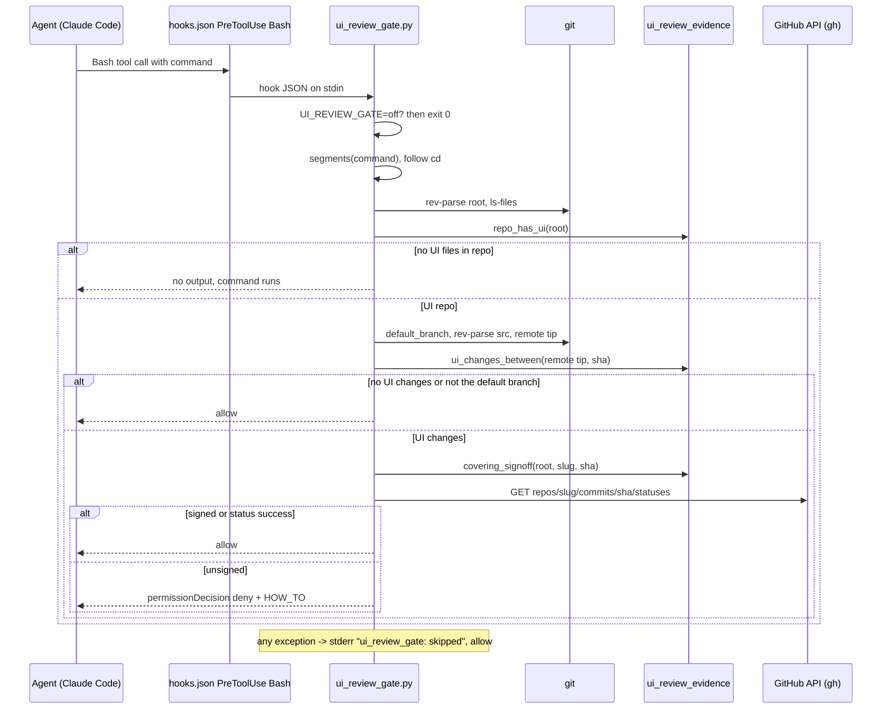
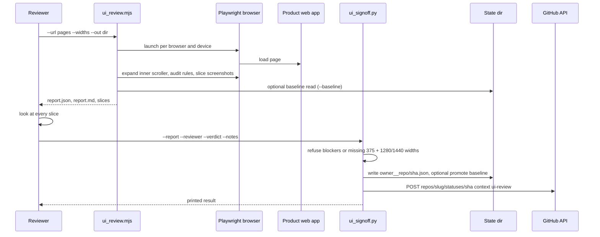
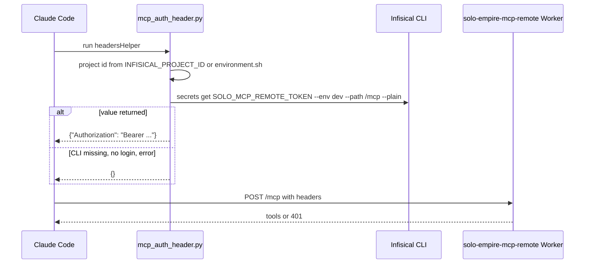
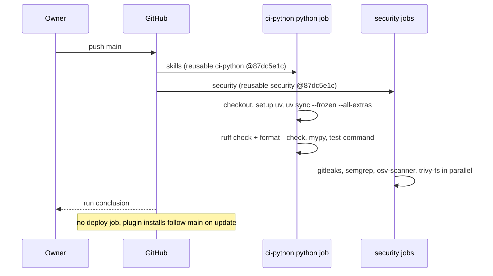

# 10 — Sequences

## S1 — PreToolUse gate on `git push` to the default branch

Sources: hooks/hooks.json, qa-testing/scripts/ui_review_gate.py (`main`, `git_push_target`, `check_push`, `default_branch`), qa-testing/scripts/ui_review_evidence.py

## S2 — Capture, review and sign off

Sources: qa-testing/scripts/ui_review.mjs, qa-testing/scripts/ui_signoff.py, qa-testing/scripts/ui_review_evidence.py, qa-testing/scripts/ui_visual_diff.mjs

## S3 — Tool hub MCP connect

Sources: .mcp.json, hooks/mcp_auth_header.py. พฤติกรรม 401 ของ Worker อ้างจาก docstring ของ helper; โค้ด Worker อยู่ใน repo platform-mcp-remote-worker

## S4 — CI on push to main

Sources: .github/workflows/ci.yml, platform-ci-workflows@87dc5e1c .github/workflows/ci-python.yml and security.yml

## Open questions

- ไม่มี
