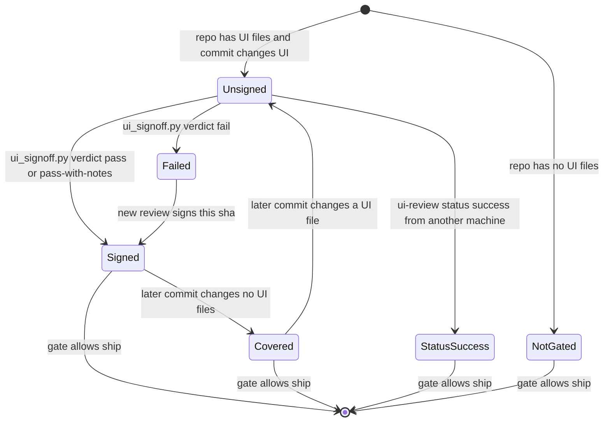
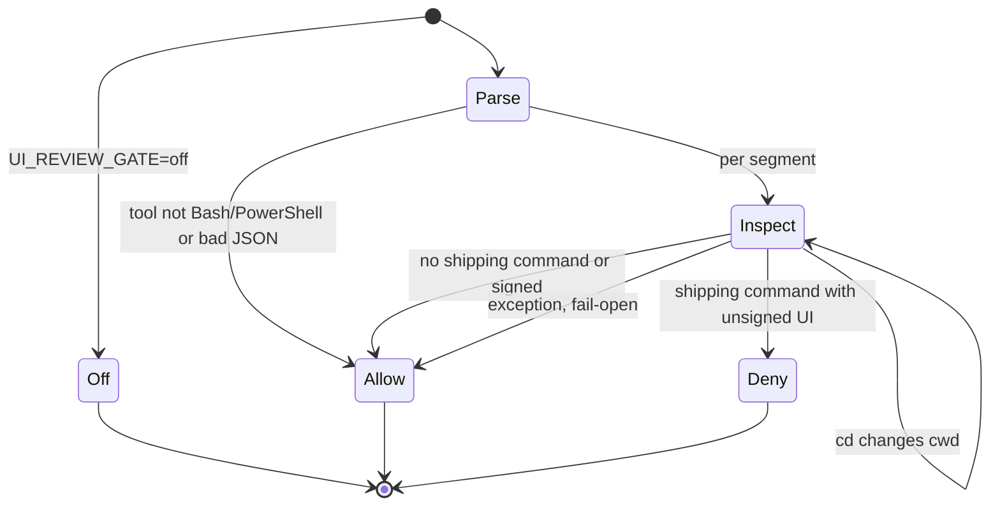
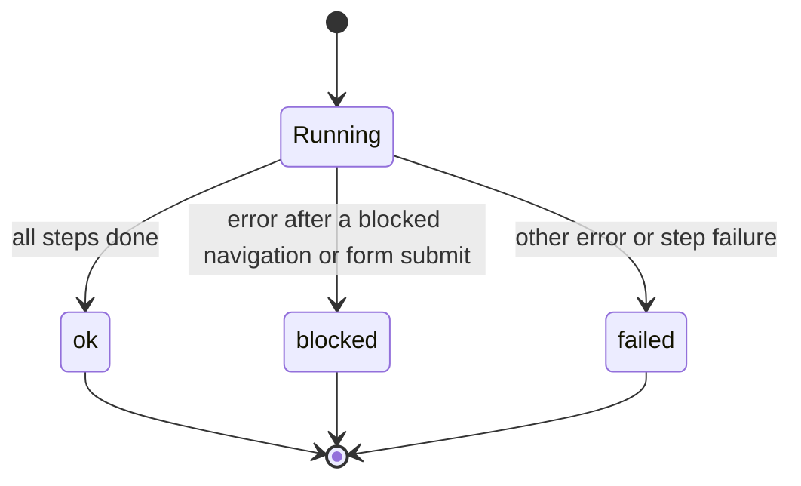

# 11 — State machines

ไม่มี entity ใน database; lifecycle ที่มีในโค้ดจริงคือสถานะของ commit ในมุมของ UI review gate, verdict ของ sign-off
และสถานะของ scenario ใน flow-video

## SM1 — Commit as seen by the UI review gate

Sources: qa-testing/scripts/ui_review_evidence.py (`repo_has_ui`, `signed_shas` นับเฉพาะ `pass`/`pass-with-notes`, `covering_signoff`, `github_status`),
qa-testing/scripts/ui_review_gate.py, qa-testing/scripts/ui_signoff.py

หมายเหตุ: verdict `fail` เขียน evidence และ post status `failure` แต่ gate ไม่นับ (ไม่อยู่ใน `signed_shas`)

## SM2 — Gate decision per Bash command

Sources: qa-testing/scripts/ui_review_gate.py (`main`)

## SM3 — flow-video scenario result

Sources: flow-video/scripts/flow_video.mjs (`status: error ? (blockedNav ? "blocked" : "failed") : "ok"`, line ~583; `status: "failed"` line ~699)

## Open questions

- ไม่มี
