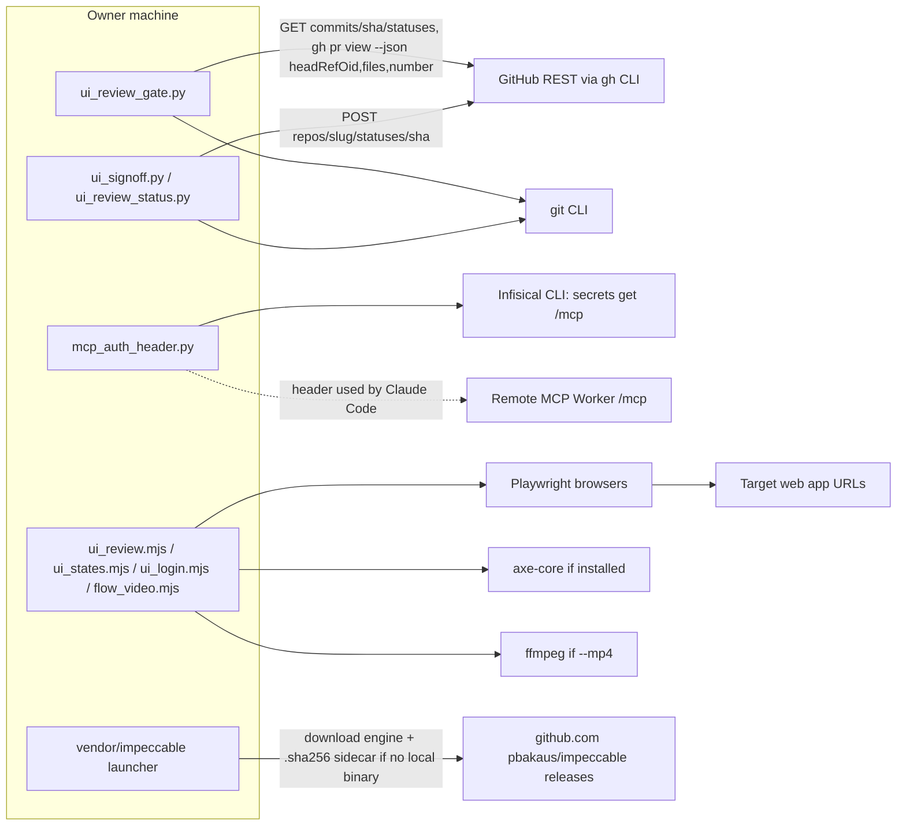

# 12 — API & integrations

repo นี้ **ไม่ serve endpoint ใด**. interface ที่มีคือ (a) Claude Code plugin contract, (b) CLI ของ scripts, (c) การเรียกออกไปยังบริการภายนอก

## Interfaces exposed

| Interface | Form | Contract |
|---|---|---|
| Plugin manifest | `.claude-plugin/plugin.json`, `marketplace.json` | plugin `solo`, skills `./`, `./vendor/` |
| PreToolUse hook | `hooks/hooks.json` | stdin hook JSON (`tool_name`, `tool_input.command`, `cwd`) → stdout `hookSpecificOutput.permissionDecision: "deny"` หรือไม่มี output |
| MCP registration | `.mcp.json` | server `solo-empire`, type `http`, URL `https://solo-empire-mcp-remote.bookchaowalit.workers.dev/mcp`, `headersHelper` |
| Governance audit | `python3 scripts/skill_governance.py --json` | JSON contract `solo-empire.skill-governance.v1` |
| Sign-off CLI | `ui_signoff.py --repo --sha --report --reviewer --verdict --notes [--accept-blockers] [--promote-baseline] [--no-github-status] [--baseline-dir]` | exit 0/1/2 |
| Status CLI | `ui_review_status.py --repo --base --sha` | exit 0/1/2 |
| Capture CLIs | `ui_review.mjs`, `ui_states.mjs`, `ui_login.mjs`, `flow_video.mjs` | options ตาม header ของแต่ละไฟล์ |

## External integrations (outbound)

Sources: qa-testing/scripts/ui_review_gate.py (`check_merge`), qa-testing/scripts/ui_review_evidence.py (`post_status`, `github_status`, `git`),
hooks/mcp_auth_header.py, .mcp.json, qa-testing/scripts/ui_review.mjs, qa-testing/scripts/ui_a11y_perf.mjs (`AXE_CORE_PATH`),
qa-testing/scripts/ui_browsers.mjs (`PLAYWRIGHT_MODULE`), flow-video/scripts/flow_video.mjs (`FLOW_VIDEO_FFMPEG`),
vendor/impeccable/scripts/impeccable (`IMPECCABLE_DOWNLOAD_BASE` default)

Kill switches / env ที่เปลี่ยนการเชื่อมต่อ: `UI_REVIEW_GATE=off`, `UI_REVIEW_GITHUB_STATUS=off`, `UI_REVIEW_STATE_DIR`, `PLAYWRIGHT_MODULE`, `AXE_CORE_PATH`

ไม่มี webhooks และไม่มี third-party SDK ใน Python dependencies (`pyproject.toml` มีแค่ `pyyaml`; dev: `mypy`, `types-pyyaml`)

## Open questions

- tools ที่ Worker เปิดให้ (list_cells, describe_cell, call_cell, CRM/AI) อยู่ใน repo platform-mcp-remote-worker; README repo นี้ระบุไว้แต่ไม่ได้ตรวจซ้ำที่นี่
