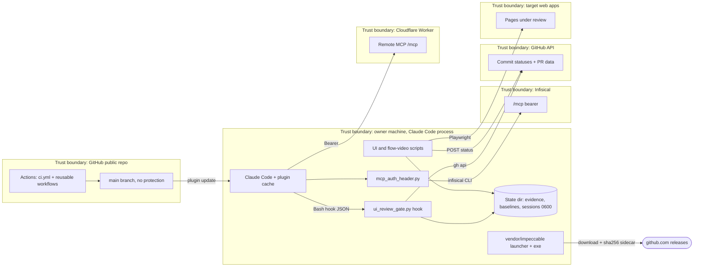

# 13 — Threat model (DFD + STRIDE)

ขอบเขต: plugin `solo` ที่ถูกดึงจาก GitHub ไปรันบนเครื่องของ owner (hooks + helpers + scripts) และ supply chain ของมัน

Sources: .claude-plugin/*.json, hooks/hooks.json, .mcp.json, hooks/mcp_auth_header.py, qa-testing/scripts/*, flow-video/scripts/flow_video.mjs,
vendor/impeccable/scripts/impeccable, .github/workflows/ci.yml, GitHub API `repos/bookchaowalit/platform-agent-skills/branches/main/protection` → 404 (2026-11-04)

## STRIDE per element

| Element | Threat | Existing mitigation (in code) | Gap |
|---|---|---|---|
| main branch → plugin (supply chain) | **T**ampering: commit ที่เป็นอันตรายถึงทุกเครื่องเพราะ plugin ไม่มี version | CI `security` (gitleaks, semgrep, osv-scanner, trivy-fs); actions pinned by SHA; renovate `pinGitHubActionDigests` | `main` ไม่มี branch protection/ruleset (API 404, rulesets `[]`); CI ไม่ใช่ required check; hook code ใหม่รันทันทีหลัง update |
| main branch | **R**epudiation: ใครเปลี่ยน gate | git history | ไม่มี signed commits requirement |
| ui_review_gate.py | **E**levation / bypass: ship UI โดยไม่ review | deny decision; ตรวจ `cd`, `git -C`, refspec, `--repo` | fail-open เมื่อ exception; `UI_REVIEW_GATE=off`; matcher `Bash` เท่านั้น (PowerShell ไม่ถูก hook แม้ `main` รองรับ); คำสั่ง ship รูปแบบอื่น (เช่น `git push` ผ่าน alias/script, Vercel Git auto-deploy จาก PR merge บนเว็บ) ไม่ถูกตรวจ |
| State dir evidence | **S**poofing / **T**ampering: เขียน `<sha>.json` ปลอม | อยู่นอก repo; `ui_signoff.py` ตรวจ blockers + widths | ไฟล์ไม่มี signature; ผู้ใช้เครื่องเขียนเองได้ |
| GitHub status `ui-review` | **S**poofing: ใครที่มีสิทธิ์ statuses post success ได้ | ต้องมี `gh` auth ที่มีสิทธิ์ repo | ไม่ตรวจว่าใคร post status |
| mcp_auth_header.py | **I**nformation disclosure: bearer รั่ว | อ่านจาก Infisical ตอน connect, ไม่เขียนไฟล์, `capture_output`, ไม่ print นอกจาก header JSON; fallback `{}` | ไม่มี test; project id อ่านจาก `environment.sh` ด้วย regex |
| ui_login.mjs session state | **I**nformation disclosure: session cookies | credentials จาก env เท่านั้น, ไม่ print; ไฟล์ mode 0600; default นอก repo | ไม่มีการลบอัตโนมัติ |
| flow_video.mjs on production | **T**ampering: tour เผลอเขียนข้อมูล | อนุญาตแค่ GET/HEAD/OPTIONS; writes ต้อง `writes` + `--allow-writes` + `readOnly` ไม่เป็น true | — |
| vendor/impeccable | **T**ampering: binary third-party | launcher ตรวจ `.sha256` sidecar ของไฟล์ที่ download, refuse เมื่อตรวจไม่ได้ | exe 14.7 MB commit อยู่ใน repo (`bin/windows-x64`) เป็น "sibling binary" ที่ launcher exec โดยไม่ probe/verify (บน Windows); sidecar มาจาก origin เดียวกับไฟล์ |
| Sub-agents | **E**levation: role read-only ได้ write tools | tests/plugin_agents_test.py (ไม่มี Edit/Write/NotebookEdit) | read-only roles ส่วนใหญ่ยังมี `Bash`/`PowerShell` ซึ่งเขียนไฟล์ได้ |
| CI | **D**enial of service | concurrency cancel-in-progress, timeouts ใน reusable workflows | — |
| Scripts → GitHub API | **I**nformation disclosure | `UI_REVIEW_GITHUB_STATUS=off` ปิดทุก call | description status ส่ง reviewer + counts ออกไป (public repo เห็นได้) |

## Open questions

- จะเปิด branch protection / ruleset บน `main` พร้อม required check `CI` หรือไม่ (plugin track main)?
- ควรลง hook matcher `PowerShell` ด้วยหรือไม่?
- ควรเก็บ `impeccable.exe` ใน repo ต่อหรือให้ launcher download + verify อย่างเดียว?
