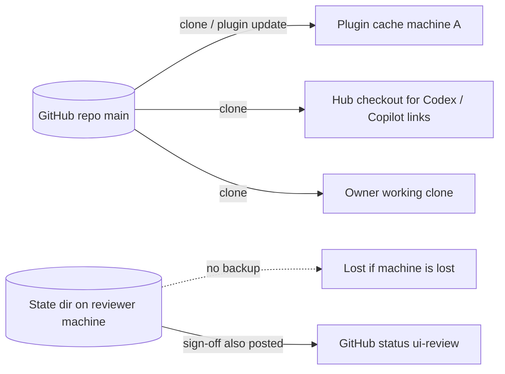

# 14 — Backup & DR

## Data inventory

| Data | Where it lives | Backup / restore reality |
|---|---|---|
| Skill packages, agents, hooks, scripts, tests | GitHub `bookchaowalit/platform-agent-skills` (public, `main`) | Git เอง: ทุก clone (เครื่อง owner, plugin cache ของแต่ละเครื่อง, hub checkout ที่ link) เป็นสำเนาเต็ม; ไม่พบ backup workflow แยกใน `.github/workflows/` |
| Plugin install copy | plugin root (`${CLAUDE_PLUGIN_ROOT}`) ของแต่ละเครื่อง | สร้างใหม่ได้จาก GitHub ด้วย plugin update / install |
| UI review evidence + baselines | `$UI_REVIEW_STATE_DIR` หรือ `~/.local/state/ui-review/<owner>__<repo>/` บนเครื่องที่ sign off | **ไม่มี backup** ในโค้ด; ถ้าหาย sign-off ที่ post เป็น GitHub status `ui-review` ยังนับให้ gate (`github_status`) แต่ baseline สำหรับ visual diff หาย |
| Login session state | `~/.local/state/ui-review/sessions/*.json` (0600) | ไม่ backup โดยตั้งใจ (secret ชั่วคราว); สร้างใหม่ด้วย `ui_login.mjs` |
| Tool hub bearer | Infisical `/mcp` | อยู่นอก repo นี้ (backup ของ Infisical ไม่อยู่ในขอบเขต repo) |
| CI artifacts (SARIF) | GitHub Actions artifacts, `retention-days: 14` | หมดอายุ 14 วัน (reusable security.yml) |

Sources: README.md, qa-testing/scripts/ui_review_evidence.py (`state_dir`, `evidence_dir`, `baseline_dir`, `github_status`), qa-testing/scripts/ui_login.mjs,
.github/workflows/ci.yml, platform-ci-workflows@87dc5e1c security.yml (`retention-days: 14`), hooks/mcp_auth_header.py

## Restore procedure (จากสิ่งที่มีจริง)

1. Repo หาย/เสีย: push จาก clone ใดก็ได้กลับไป GitHub (ไม่มี runbook เขียนไว้)
2. เครื่องหาย: ติดตั้ง plugin ใหม่ตาม README; evidence ในเครื่องหายแต่ status บน GitHub ยังใช้ได้

## RTO / RPO

**not defined** (ไม่พบใน PRODUCT.md, README.md หรือ docs ของ repo)

## Open questions

- ควรมี RTO/RPO สำหรับ skill hub หรือไม่ (ทุก agent ใช้)?
- baselines ใน state dir ควร sync ไปที่ใดที่ host อยู่ (เช่น R2) หรือไม่?
