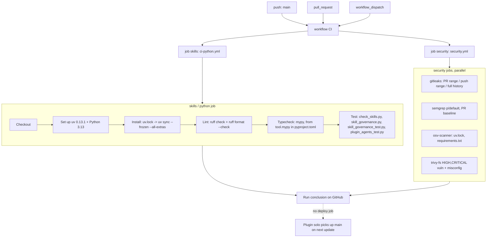

# 15 — CI/CD pipeline

workflow เดียว: `.github/workflows/ci.yml` (name `CI`), `permissions: contents: read`, concurrency `ci-${{ github.ref }}` cancel-in-progress.
ทั้งสอง job เป็น reusable workflow จาก `bookchaowalit/platform-ci-workflows` ที่ SHA `87dc5e1c7e0416886a6371d5a101bb2ccba38edd` (v1.1.1), runner default `"ubuntu-24.04"`

Sources: .github/workflows/ci.yml, platform-ci-workflows@87dc5e1c `.github/workflows/ci-python.yml` (steps, `UV_VERSION`, default `python-version` 3.13),
`.github/workflows/security.yml` (jobs gitleaks, semgrep, osv-scanner, trivy-fs), pyproject.toml, uv.lock, requirements.txt

Steps ที่ถูก skip ใน repo นี้: `Start PostgreSQL` (`postgres` false), `Coverage gate` (`coverage-threshold` ว่าง)

## Gaps เทียบกับ `task check` (Taskfile.yml)

| Check | `task check` | CI |
|---|---|---|
| check_skills.py, skill_governance.py, skill_governance_test.py, plugin_agents_test.py | yes | yes |
| tests/ui_review_gate_test.py (18 tests) | yes | **no** |
| `node --check` ของ 7 scripts + 8 Node fixture tests | yes | **no** (ไม่มี Node/Playwright step) |
| Ruff + mypy | no | yes |

ประวัติ: CI run แรก 2026-10-17 (PR #1); main push runs 22 ครั้ง, fail 1 ครั้ง (`5c7d68b`, แก้ใน `b9c4919`) ตาม `gh run list` (2026-11-04)

## Open questions

- ต้องการ required status check บน `main` หรือไม่ (ตอนนี้ไม่มี branch protection)?
