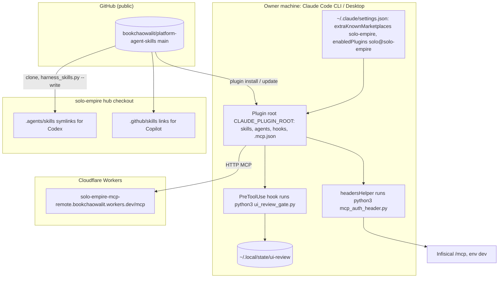

# 16 — Deployment (distribution)

ไม่มี hosted runtime ของ repo นี้ (PRODUCT.md: "Not deployed"). การ "deploy" = การกระจาย checkout ของ `main` ไปยัง harness

Sources: README.md (Install as a Claude Code plugin, Using the skills from a harness), PRODUCT.md (Operating Context, Users), .claude-plugin/plugin.json,
.claude-plugin/marketplace.json, hooks/hooks.json, .mcp.json, hooks/mcp_auth_header.py, qa-testing/scripts/ui_review_evidence.py,
ops record: hosted-shared-services (2026-11-03: "Installed user-scope"; cloud sessions do not install repo-declared plugins)

| Item | Value |
|---|---|
| Version pinning | none: plugin.json ไม่มี `version` → track latest commit บน `main` |
| Runtime requirement บนเครื่อง | `python3` (hooks, helper), `git`, `gh` (gate/status), `infisical` CLI (tool hub), Node + Playwright (capture scripts, optional) |
| Python deps (validators/CI) | `pyyaml>=6.0.2,<7` (requirements.txt, pyproject.toml), lock ใน uv.lock |
| Environments | ไม่มี staging/prod แยก; Infisical env ที่ helper อ่านคือ `dev` |
| Domains | ไม่มี domain ของ repo นี้; MCP endpoint เป็น workers.dev ของ repo อื่น |
| Claude Code cloud sessions | ไม่ติดตั้ง plugin (README) |

## Open questions

- ต้องการ release channel ที่ pin ได้ (เช่น `version` หรือ tag) สำหรับเครื่องที่ไม่อยากรับ main ทันทีหรือไม่?
