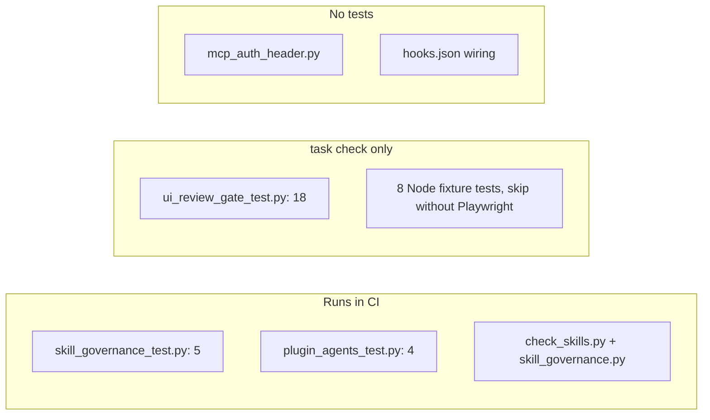

# 17 — Test coverage matrix

ระดับ test ใน repo นี้: **unit** = unittest ที่เรียก function ตรง, **integration** = รัน script จริงกับ temp git repo / fixture HTML / local HTTP server,
**e2e** = ไม่มี (ไม่มี test ที่รันผ่าน Claude Code จริง). ไม่มี coverage measurement (`coverage-threshold` ว่างใน ci.yml)

| Feature | Unit | Integration | E2E | Runs in CI? | File |
|---|---|---|---|---|---|
| SKILL.md / openai.yaml validation | yes | yes (audit ทั้ง repo) | — | yes | tests/skill_governance_test.py |
| README inventory diff | — | yes | — | yes | tests/skill_governance_test.py `test_repository_skill_system_passes` |
| Router overlap audit | skip path only | — | — | yes (skip) | `test_router_audit_is_skipped_without_router_path` |
| Role coverage audit | — | conditional (skip without solo-architecture) | — | skipped | `test_role_coverage_candidates_when_architecture_is_present` |
| Tool-selection policy text in ai-agent-workflows | yes | — | — | yes | `test_tool_selection_policy_is_capability_first_and_context_bounded` |
| Sub-agent frontmatter | yes | — | — | yes | tests/plugin_agents_test.py (4 tests) |
| check_skills.py | — | run as script | — | yes | ci.yml test-command |
| UI gate: vercel prod / merge / push / cd / -C / off switch | — | yes (temp git repos, mocked gh) | — | **no** | tests/ui_review_gate_test.py (18 tests) |
| Sign-off rules, baseline promote, GitHub status | — | yes | — | **no** | tests/ui_review_gate_test.py |
| ui_review_status.py | — | yes | — | **no** | `test_status_script_refuses_ui_changes_and_marks_others` |
| ui_review.mjs rules | — | yes (fixture HTML) | — | **no**, skip w/o Playwright | tests/ui_review_fixture_test.mjs |
| Inner scroller expansion | — | yes | — | **no** | tests/ui_inner_scroller_fixture_test.mjs |
| ui_states.mjs | — | yes | — | **no** | tests/ui_states_fixture_test.mjs |
| ui_login.mjs | — | yes (local server) | — | **no** | tests/ui_login_fixture_test.mjs |
| Visual baseline diff | — | yes | — | **no** | tests/ui_baseline_fixture_test.mjs |
| Cross-browser / devices | — | yes | — | **no** | tests/ui_cross_browser_fixture_test.mjs |
| axe-core + perf | — | yes | — | **no** | tests/ui_a11y_perf_fixture_test.mjs |
| flow_video.mjs | — | yes (local two-role app) | — | **no** | tests/flow_video_fixture_test.mjs |
| mcp_auth_header.py | **gap** | **gap** | — | — | none |
| hooks.json wiring (matcher, path) | **gap** | **gap** | **gap** | — | none |
| vendor/impeccable | out of scope (third-party) | — | — | — | — |

Sources: tests/*.py, tests/*.mjs, tests/fixtures/, Taskfile.yml, .github/workflows/ci.yml. ผลรันในเครื่อง 2026-11-04: governance 5 OK, gate 18 OK,
plugin agents 4 OK, `ui_review_fixture_test.mjs` "skipped (Playwright not installed)"

## Open questions

- Node fixture tests ผ่านล่าสุดเมื่อไหร่บนเครื่องที่มี Playwright? ไม่มีหลักฐานใน CI
