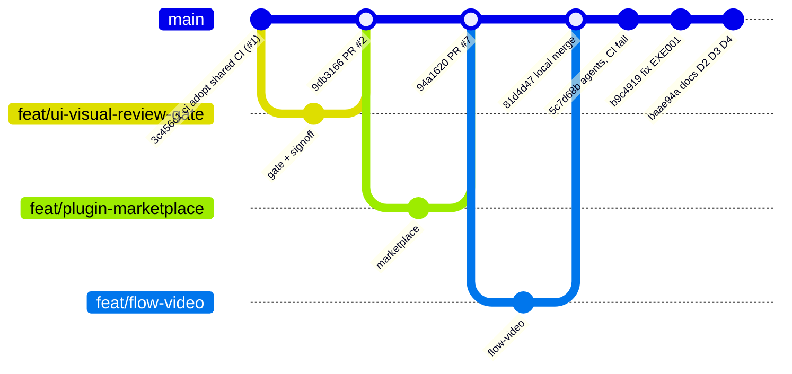
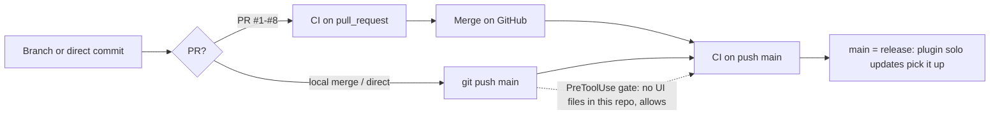

# 18 — Git & release workflow

repo สร้างบน GitHub 2026-10-11 (`gh repo view` createdAt) จากประวัติของ hub (commits ก่อนหน้านั้นเป็น history ที่ย้ายมา).
`main` เป็น default branch, **ไม่มี branch protection** (API 404) และ rulesets ว่าง. ไม่มี git tag/release

รูปแบบที่เห็นใน `git log --first-parent origin/main`:
1. 2026-10-17 → 2026-10-18: feature branch + GitHub PR (#1–#8, merge commit "Merge pull request #N")
2. 2026-10-18 → 2026-10-21: feature branch + **local merge** แล้ว push ("Merge branch 'feat/…'") — PR #9 ถูกปิดโดยไม่ merge แต่ branch ถูก merge local ใน `5362793`
3. 2026-10-21 → 2026-10-23: commit ตรงบน `main`

Sources: git log origin/main --first-parent, `gh pr list --state all` (2026-11-04), `gh api repos/bookchaowalit/platform-agent-skills/branches/main/protection` (404),
`gh api .../rulesets` (`[]`), `gh repo view --json createdAt`, .claude-plugin/plugin.json, qa-testing/scripts/ui_review_evidence.py (`repo_has_ui`)

นโยบายที่ skill ของ repo นี้เองกำหนด: `main-only-development/SKILL.md` (สำหรับ root repo ของ hub) และ `ops record: merge-locally (2026-11-03)`
(merge ใน local clone แล้ว push) ซึ่งตรงกับรูปแบบ 2–3

## Open questions

- ควรกลับไปใช้ PR + required check สำหรับ repo ที่ทุกเครื่องรันโค้ด hook หรือไม่?
