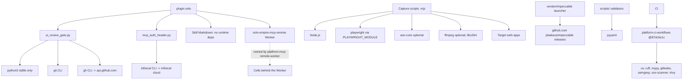

# 19 — Service dependency map

runtime dependency ของสิ่งที่ plugin รันบนเครื่อง (ไม่มี DB, ไม่มี CDN)

Sources: hooks/hooks.json, qa-testing/scripts/ui_review_gate.py, qa-testing/scripts/ui_review_evidence.py (imports: json, os, re, shutil, subprocess),
hooks/mcp_auth_header.py, .mcp.json, qa-testing/scripts/ui_browsers.mjs, qa-testing/scripts/ui_a11y_perf.mjs, flow-video/scripts/flow_video.mjs,
vendor/impeccable/scripts/impeccable, scripts/skill_governance.py (`import yaml`), pyproject.toml, .github/workflows/ci.yml,
platform-ci-workflows@87dc5e1c ci-python.yml / security.yml

| Dependency | Failure effect (จากโค้ด) |
|---|---|
| git ไม่อยู่ / ไม่ใช่ repo | gate allow (`repo_root` → None) |
| gh ไม่มี auth | `github_status` → None; gate ตัดสินจาก evidence ในเครื่อง; signoff พิมพ์ "GitHub status not posted" |
| infisical CLI / login | helper พิมพ์ `{}` → tool hub 401 |
| Playwright ไม่มี | capture scripts ทำงานไม่ได้; fixture tests skip (exit 0) |
| pyyaml | `skill_governance.py` import fail → `task check` / CI fail |

## Open questions

- ไม่มี
