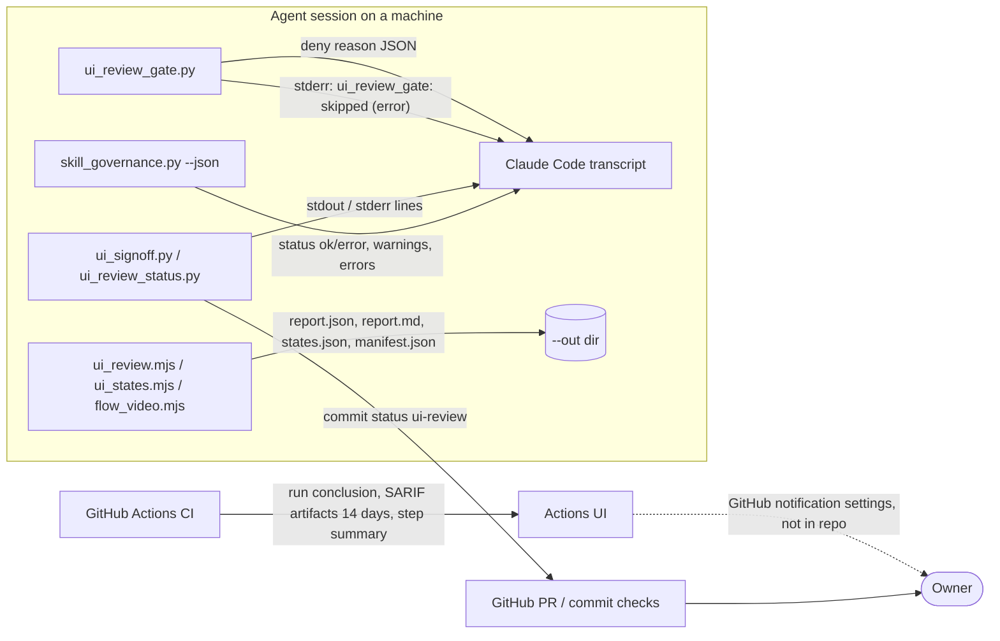

# 20 — Observability

ไม่มี Sentry / PostHog / uptime / heartbeat โดยการตัดสินใจ (PRODUCT.md: "Sentry does not apply", ดู [ADR-0006](08-adr/ADR-0006-no-sentry-in-agent-scripts.md)).
สัญญาณที่มีจริงคือ output ของ scripts ใน session, GitHub commit status และผล CI

Sources: PRODUCT.md, qa-testing/scripts/ui_review_gate.py (`deny`, `main` except branch), qa-testing/scripts/ui_signoff.py, qa-testing/scripts/ui_review_status.py,
qa-testing/scripts/ui_review.mjs, ux-review/scripts/ui_states.mjs, flow-video/scripts/flow_video.mjs, scripts/skill_governance.py,
.github/workflows/ci.yml, platform-ci-workflows@87dc5e1c security.yml (upload-artifact `retention-days: 14`, `GITHUB_STEP_SUMMARY`)

| What is watched | Signal | Who sees it |
|---|---|---|
| Package validity | CI `skills` job conclusion | GitHub Actions |
| Secrets / SAST / deps / IaC | CI `security` jobs + SARIF artifacts | GitHub Actions |
| UI release decisions | deny message in session; status `ui-review` บน commit | agent + PR viewers |
| Gate failure (fail-open) | บรรทัด stderr ใน session เท่านั้น | **gap**: ไม่มีที่รวมหรือแจ้งเตือน |
| Missed gates (PRODUCT.md Measures) | — | **gap**: `[ต้องยืนยัน]` |
| Dependency updates | renovate.json (schedule Monday before 9am, vulnerabilityAlerts) | ไม่พบ PR จาก Renovate ใน `gh pr list` → ไม่ยืนยันว่าทำงาน |

## Open questions

- Renovate app ติดตั้งบน repo นี้หรือไม่ (ไม่มี PR จาก Renovate ใน 9 PRs ที่มี)?
- ต้องการนับ gate deny / fail-open ต่อเครื่องหรือไม่ โดยไม่ส่ง prompt/paths ออกไป (ข้อจำกัดของ ADR-0006)?
