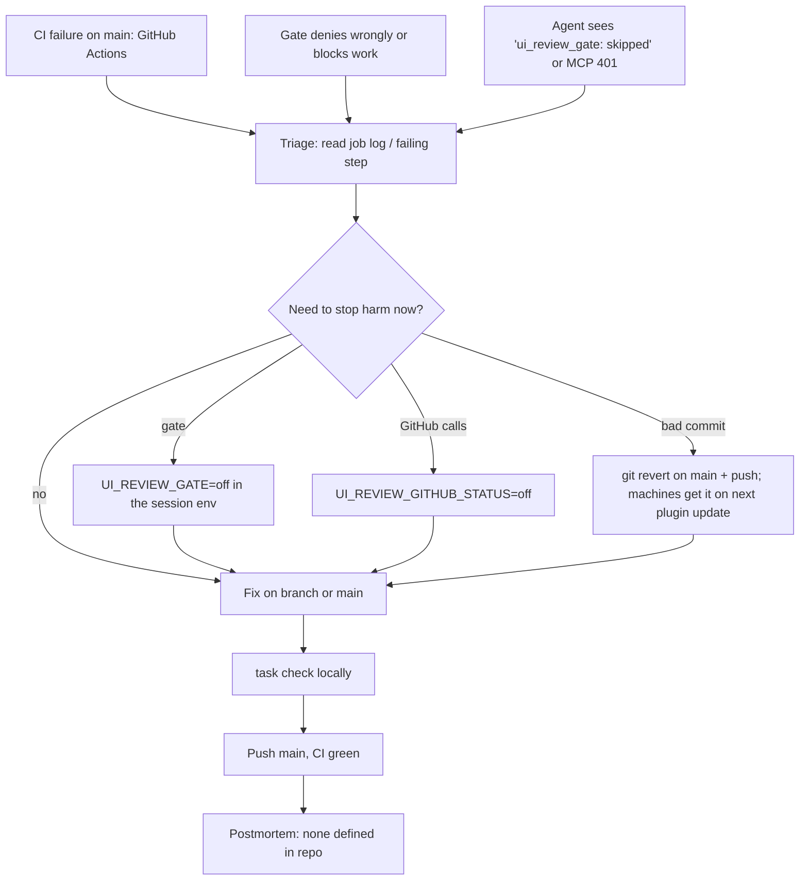

# 21 — Incident response

ไม่มี alert channel ใน repo (ไม่มี Telegram/Sentry/uptime; ดู 20). "incident" ที่เกิดได้จริงคือ (a) CI บน `main` แดง, (b) commit บน `main`
ทำให้ hook/helper/skill พังบนทุกเครื่องหลัง plugin update, (c) gate บล็อกผิด หรือ fail-open

Sources: qa-testing/scripts/ui_review_gate.py (off switch, fail-open), qa-testing/scripts/ui_review_evidence.py (`UI_REVIEW_GITHUB_STATUS`),
hooks/mcp_auth_header.py, README.md, Taskfile.yml, .github/workflows/ci.yml, git log origin/main

## Real case in the window

| Time (UTC) | Event | Evidence |
|---|---|---|
| 2026-10-21 16:42 | CI run on `5c7d68b` (ship 9 sub-agents) = failure | `gh run list` |
| 2026-10-21 16:44 | `b9c4919` "fix: mark plugin_agents_test.py executable (Ruff EXE001)" → CI success | git log, `gh run list` |
| — | Recovery ≈ 2 นาที (CI fail → CI green); ไม่มี postmortem | |

อื่น ๆ: `d3d24e5` → revert `9849ddc` → re-apply `0cd6935` (2026-10-13, repository renames) ไม่มี CI ในตอนนั้น (CI เริ่ม 2026-10-17)

## Open questions

- ใครได้รับแจ้งเมื่อ CI บน `main` fail (GitHub notification settings ไม่อยู่ใน repo)?
- ต้องมี postmortem template สำหรับ skill hub หรือไม่ (ทุก agent ได้รับผล)?
- วิธี rollback เครื่องที่ update plugin แล้วนอกจาก revert บน main คืออะไร?
