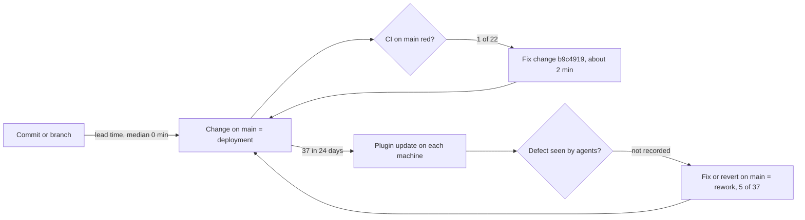

# 22 — DORA metrics

ช่วงวัด: 90 วัน 2026-08-06 → 2026-11-04 ที่ `origin/main` `baae94a`. repo ถูกสร้างบน GitHub **2026-10-11T15:04Z** และ commits ก่อนหน้านั้น
เป็น history ของ hub ที่ย้ายมา จึงวัดจริงเฉพาะช่วง 2026-10-11T15:04Z → 2026-11-04 (24 วัน); CI มีตั้งแต่ 2026-10-17 เท่านั้น.
นิยาม: **deployment = first-parent change ที่ลง `main`** เพราะ plugin `solo` ไม่มี version และ track `main` ([ADR-0002](08-adr/ADR-0002-plugin-marketplace-tracks-main.md))

| Metric | วิธีวัดสำหรับ repo นี้ | ค่า |
|---|---|---|
| Deployment frequency | นับ first-parent commits บน main ตั้งแต่สร้าง repo | **37 changes / 24 วัน** (~1.5/วัน) แต่กระจุก: 2026-10-11..13 (11), 10-17..18 (15), 10-21..23 (11); **0 ตั้งแต่ 2026-10-23**. นับรวม hub history ใน 90 วัน = 80 |
| Lead time for changes | merge: author time ของ commit แรกใน branch → committer time ของ merge; direct: author → committer | **median 0 นาที** (n=37); ค่าไม่เป็นศูนย์: 1, 1, 2, 3, 5, 9, 17, 446 (feat/flow-video), 4727 (~3.3 วัน, feat/expand-inner-scroller / PR #9) |
| Change fail rate | (a) CI fail บน main push / main push runs; (b) changes ที่ต้องมี fix/revert ตามมาบน main | (a) **1/22 ≈ 4.5%** (`5c7d68b`); (b) production failure ต่อเครื่อง: **cannot compute** (ไม่มี incident record) — inferred upper bound ดู rework |
| Failed deployment recovery time | CI fail → CI success บน main ถัดไป | **≈ 2 นาที** (n=1: 16:42:55Z → 16:44:58Z, 2026-10-21); recovery บนเครื่องผู้ใช้: **cannot compute** |
| Deployment rework rate | first-parent changes ที่เป็น fix/revert ของ change ก่อนหน้าบน main / changes | **5/37 ≈ 14%**: `9849ddc` (revert), `98a119b`, `7949eca`, `71255cc`, `b9c4919` |

Commands (รันใน worktree, 2026-11-04):

```bash
# repo creation time
gh repo view bookchaowalit/platform-agent-skills --json createdAt
# deployment frequency
git log origin/main --since='2026-10-11T15:04:01Z' --first-parent --format='%h %cI %s'
git log origin/main --since=2026-08-06 --first-parent --oneline | wc -l
# lead time (minutes) per first-parent change
for m in $(git log origin/main --since='2026-10-11T15:04:01Z' --first-parent --format=%h); do
  p=$(git rev-list --parents -n1 $m | wc -w)
  if [ $p -gt 2 ]; then first=$(git log --format=%at $m^1..$m^2 | sort -n | head -1); else first=$(git log -1 --format=%at $m); fi
  echo "$m $(( ($(git log -1 --format=%ct $m) - first) / 60 ))"
done
# CI outcome on main
gh run list -R bookchaowalit/platform-agent-skills --limit 200 --json event,headBranch,conclusion,createdAt,headSha \
  --jq '.[] | select(.event=="push" and .headBranch=="main") | "\(.createdAt) \(.headSha[0:7]) \(.conclusion)"'
# rework candidates
git log origin/main --since='2026-10-11T15:04:01Z' --first-parent --format='%h %s' | grep -Ei 'fix|revert'
```



Sources: git log origin/main, `gh run list` (2026-11-04), `gh repo view --json createdAt`, .claude-plugin/plugin.json

ข้อจำกัด: commit ตรงบน main และ squash ทำให้ author time ≈ committer time → lead time ต่ำเกินจริง; "deployment" จริงเกิดเมื่อแต่ละเครื่อง update plugin
ซึ่งไม่มี log; rework นับจากข้อความ commit (`fix`, `Revert`) ร่วมกับการดูว่าแก้ของที่ลง main ก่อนหน้า (`286907d`, `0cd6935` ไม่นับเพราะเป็น follow-up/re-apply ไม่ใช่การแก้ defect)

## Open questions

- จะวัด deployment จริง (เวลาที่เครื่องได้ plugin ใหม่) อย่างไร?
- จะบันทึก defect ที่ agent เจอจาก skill/hook ที่ไหน เพื่อคำนวณ change fail rate และ recovery time?
