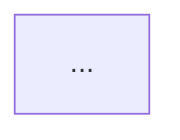

# As-Is / To-Be standard (`docs/diagrams/01-business-process.md`)

Every system keeps one As-Is / To-Be file so people and AI agents see the same
picture before they change the system. The hub report
(`task report:as-is-to-be` in `platform-ops-cli`) reads these files from every
clone and draws them side by side with the gap progress, so the layout below is
a contract: keep the headings, the `Last reviewed` line and the gap table
columns exactly as written.

One file per repository, at the repository root. The report reads only that
path. A repository that holds several systems (for example an app under
`apps/<name>/`) keeps the main system in the root file and may add
`<subdir>/docs/diagrams/01-business-process.md` for the others; the report does
not read those yet, so link each from the root file's Open questions.

## Layout

````markdown
# 01 — Business process (As-Is / To-Be)

<1–3 sentences: what the system is and who uses it, in Thai>

Last reviewed: 2026-11-26 · commit `abc1234`

## As-Is (จากโค้ดวันนี้)



Sources: `path/one.ts`, `README.md`

## To-Be (<where it comes from: spec, PRODUCT.md, ADR>)


Sources: `specs/SPEC-002.md`

## Gap

| ID | As-Is → To-Be | Status | Owner | Evidence |
|---|---|---|---|---|
| G1 | static tokens → workspace JWT | doing | claude | `specs/SPEC-002.md`, PR #41 |
| G2 | single replica → shared admission | decide | owner | owner item `gw-shared-mode` |

## Open questions

- ...
````

## Rules

- **As-Is comes from code only.** Name the files and the commit you read. A
  fact you could not confirm gets **[ต้องยืนยัน]**.
- **To-Be comes from a written source only**: a spec, `PRODUCT.md`, an ADR, an
  upgrade plan or a recorded owner decision. If none exists, write
  `ไม่มี To-Be ที่เขียนไว้` with no diagram, and add a `decide` gap
  that asks the owner for one. Never invent a target state.
- **The first `mermaid` block under each heading is the one the report draws.**
  Extra diagrams (a sub-process, a sequence) may follow it. Use the same
  diagram type and node names on both sides where you can, so the change is
  visible.
- **Gap table.** One row per difference between As-Is and To-Be.
  - `ID`: `G1`, `G2`, … stable across edits; never reuse a closed ID.
  - `Status`: one of `done`, `doing`, `todo`, `blocked`, `decide`
    (`decide` = waiting for an owner decision).
  - `Owner`: `owner`, `claude`, `codex` or a role; never a personal name or
    contact.
  - `Evidence`: the spec, PR, issue, owner-board item or commit that proves the
    status. A `done` row without evidence counts as `todo`.
  - A `|` inside a cell is written `\|`; the report reads it as a literal pipe.
- **Keep it current.** Update the file in the same change that:
  merges a spec or feature that moves a gap, changes the process the As-Is
  shows, or lands a new To-Be source. Bump `Last reviewed` and the commit each
  time. The report marks a file older than 30 days as stale.
- **No secrets, personal data or client payloads** in any diagram or row.

## Before larger work

Before you start a spec, a feature or a refactor in a system, open its
`01-business-process.md` in the checkout or worktree you are editing and say
which gap the work moves (or "no gap moved" for a refactor that leaves the
process as it is). The hub report reads the clone folder, not your worktree, so
use it for the cross-system picture only; to see your branch in it, run
`task report:as-is-to-be -- --root <folder holding your worktree>`. If the file
is missing, write it first from the code and the specs.
